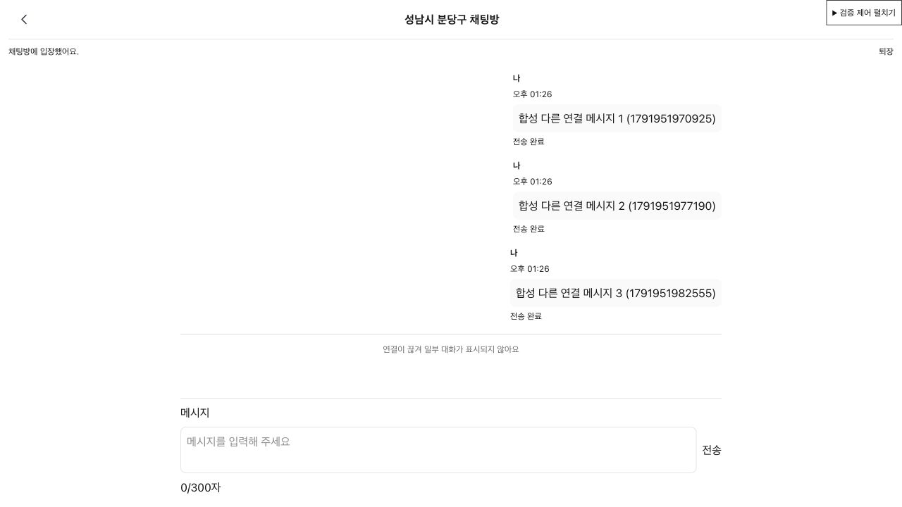
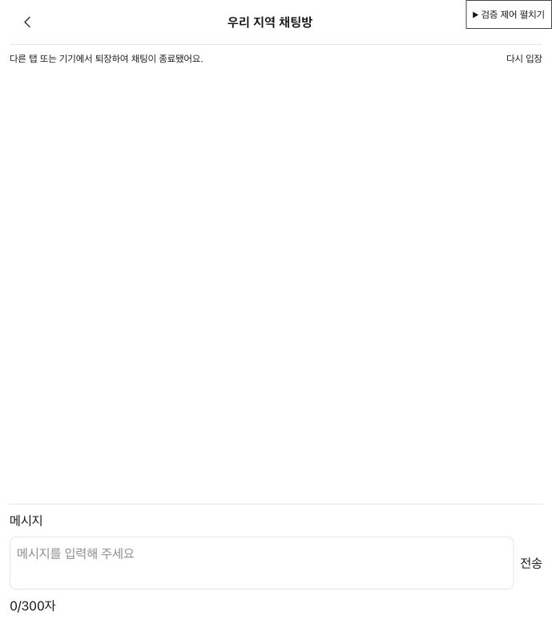

# 모바일 크기·다중 연결의 메시지 복구와 이전 대화 검증

[FE #141](https://github.com/100-hours-a-week/KTB4-18th-FE/issues/141).
관련 서버 검증은 BE api/chat-recovery-process-verification.md를 따른다.

## 재현 환경

- 2026-10-14, Mac의 Codex in-app 브라우저, viewport390×844.
- 실제 별도 JVM Spring Boot·HTTP·WebSocket·MySQL9.7.0 격리 환경.
- 실제 ChatEntryPage/useChatParticipation/ChatParticipation/채팅 API 모듈을 사용한다.
  메시지/입장/조회/퇴장 API는 Mock하지 않는다.
- 합성 JWT를 실제 인증 모듈에 설치·제거한다. 로그인/refresh 쿠키 발급을 검증하는 환경은 아니다.
- 위치 좌표와 브라우저 geolocation, 외부 Kakao 응답만 합성 fixture다.
  테스트 화면의 네트워크 단절은 transport를 제어한 것이다. 실제 휴대전화 라디오 단절과 구분한다.
- 테스트 제어 화면과 계정 JSON은 제품 번들 entry에 포함되지 않는다.
  chatRecovery.local.json은 Git 제외·loopback 전용이며 검증 종료에 제거한다.

## 실행

BE:

```sh
CHAT_BROWSER_FE_DIR=/absolute/path/to/meomuneum-frontend \
CHAT_RECOVERY_FE_DIR=/absolute/path/to/meomuneum-frontend \
./gradlew chatProcessTest --no-daemon
```

FE:

```sh
npm run verify:chat:types
npm run verify:chat:integration
npm run verify:chat:browser
```

첫 명령은 fixture와 연동 테스트의 TypeScript 검사, 두 번째는 실제 서버 REST/WS·캐시 자동화다.
브라우저 명령은 검증 서버를 여는 명령이며 자체적으로 테스트 통과를 판정하지 않는다.
http://127.0.0.1:5175/tests/fixtures/chatRecovery.html을 열어 아래 제어를 수행한다.
브라우저 검증은30분 안에 완료한 뒤 BE build/chat-process-verification/browser-release 파일을 만든다.
코드 수정 중에는 검증 서버를 재시작하고 화면을 새로고침한다. 이 서버는 HMR을 사용하지 않는다.

일반 npm test에서는 서버 fixture가 없는 실제 연동 테스트가 제외된다.
verify:chat:integration은 fixture가 없으면 실패하므로 해당 제외를 성공으로 대체하지 않는다.
기존 단위 테스트를 반복 추가하지 않고 실제 입장·조회·전송·전체 퇴장·재입장 경로를 검증한다.

## 기대/실제 결과

| 단계 | 실제 결과 |
| --- | --- |
| 최초 실제 입장 | CHAT_READY 이후 입력 활성, 이전 서버 메시지0개 |
| 복구 응답 보류→다른 연결 메시지→해제 | RECOVERING 입력 비활성, 해제 후 메시지2개·중복0 |
| 다른 연결 유지→31초 초과 단절 | 단절 직전/유예의 메시지3개 표시, 부재 중4번째 메시지 제외, 공백 안내·입력 재활성 |
| 키보드 Enter | 합성 메시지 전송 완료, 대화4개 |
| 같은 탭 새로고침 | 이전에 봤던4개 복원, 안내선 표시 |
| rel=opener 두 번째 탭 | 기존4개 미복원·초기0개, 새 메시지 후 첫 탭5개/새 탭1개 |
| 첫 탭 앱 내 이동(실제 unmount/퇴장) | 두 번째 탭 종료 안내·입력 비활성·대화 제거, 자동 재입장 없음 |
| 첫 탭 재입장 | 이전에 봤던5개만 복원, 새 참여 상태와 구분 |
| quota 실패→Enter | 현재 메시지 전송 완료, 기존 인증·실시간 채팅 유지 |
| 다른 합성 계정 토큰 설치 | 이전 계정6개 메시지 미표시·새 계정0개 |
| 유효 캐시205개+24시간 만료1개 주입 | 재입장200개, 첫 항목5/마지막204, 만료 항목205 제외 |
| 손상 JSON→새로고침 | 캐시 폐기·메시지0개, 실제 연결/입력 활성 |
| 인증 제거 | 퇴장·입력 비활성·메시지 제거 |

캐시 경계 제어는 합성 캐시를 직접 준비하는 fixture다. 이 단계의200개는 서버에205건을 전송한
결과나 서버 과거 열람 권한 검증으로 해석하지 않는다. 실제 입장/연결은 그대로 사용한다.
앱 내 이동 제어는 실제 채팅 컴포넌트를 unmount/remount하며 전체 App의 내비게이션 외형을 대체한다.

## 자동 실제 서버 연동

tests/integration/chatMultiClient.integration.test.ts는 별도 node 환경에서 실행한다.
사용하는 REST 입장·현재 방 조회·위치 확인·메시지 조회·퇴장은 실제 API다.
브라우저 geolocation 대신 공개 위치 확인 API에 합성 좌표를 보내며,
실제 메시지 저장·마스킹·ACK·snapshot 복구·live 병합을 확인한다.
같은 탭의 메모리 sessionStorage 대역을 사용하므로 native browser cache 격리는 위 브라우저 결과로 구분한다.

검증 항목: 마스킹 원문/미전송 원문이 cache에 남지 않음, 복구3개 ID 중복0,
실제 REST 퇴장 후 다른 클라이언트4100, 같은 탭 새 참여에서 cache3개 복원,
퇴장 중 다른 계정이 보낸 메시지 미조회.
API base URL은 모듈 import 전에 loopback fixture로 주입한다.

## 접근성·반응형 증빙

- viewport390×844에서 상태 안내, 공백 안내, textarea·전송 버튼과 메시지 목록이 화면에 표시된다.
- 키보드 Enter 전송과 목록 role=log, 상태/공백 role=status, 입력·버튼 disabled 상태를 확인했다.
  실제 음성으로 읽는 스크린 리더 테스트를 대신하는 결과는 아니다.





## 미검증 범위와 실패 이력

- 실제 iOS Safari·Android Chrome·휴대전화 네트워크 전환/백그라운드/가상 키보드, 별도 물리 기기,
  VoiceOver/TalkBack/NVDA, native 탭 복제·닫은 탭 복원, 운영 로그인/배포는 미실행이다.
  지원 브라우저 전체 또는 실제 두 기기 검증 완료로 표시하지 않는다.
- Node 첫 연동은 모듈 import 뒤 API base URL 설정으로 초기 입장 실패했다.
  fixture 주소를 import 전 주입하는 실행 스크립트와 승인된 실제 loopback 실행으로 재검증했다.
- 테스트 UI의 직접 전역 변경·Fast Refresh 검사 오류는 제어 함수를 렌더 밖으로 분리하고
  standalone test entry에만 Fast Refresh 예외를 적용했다. 제품 코드의 린트 규칙은 변경하지 않았다.
- 개발 중 HMR의 createRoot 재등록 경고가 발생했다. 실제 검증은 코드 수정 후 명시적으로 새로고침했으며, 이후 재현 스크립트에서 HMR을 꺼 같은 문제를 방지한다.
- BE 브라우저 유지15분 만료로 마지막 선택 단계가 실패했다.30분 유지와 명시적 release로 재검증했다.
- 제품 코드의 새 결함은 확인하지 않았다. 위 환경 수정은 테스트 코드/환경에 한정한다.

## 2026-10-14 최종 검사

- format:check·ESLint·일반 Vitest463개·fixture/연동 TypeScript·production build 통과.
  일반 실행은 서버 정보가 필요한 기존/신규 실제 연동2건을 제외한다.
- 신규 실제 REST/WS·캐시 통합1건은 직접 실행과 BE의 같은 별도 JVM 환경 실행에서 통과했다.
- 기존500kB 번들 경고는 남아 있다. 제품/API 동작은 변경하지 않았으며 운영 배포·push·PR은 수행하지 않았다.
